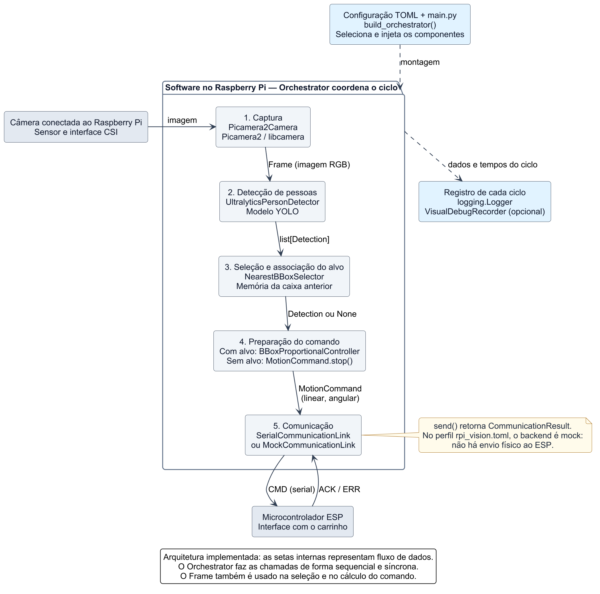
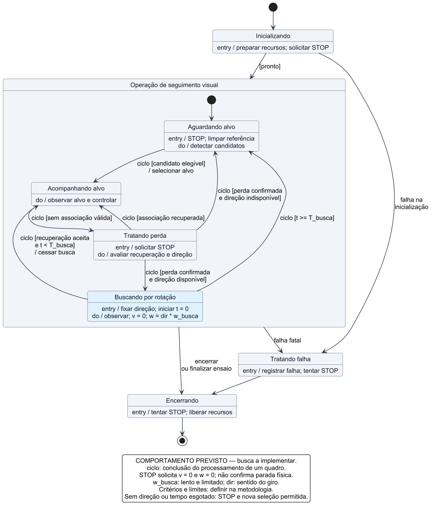

# Diagramas do software do Raspberry Pi

Versão de trabalho: **26/10/2026**. Autor do projeto: José Henrique Schmitt Fidelis.

Os diagramas documentam a organização do software e o comportamento previsto para o seguimento de pessoas. A **busca por rotação foi confirmada como comportamento desejado**; ela ainda precisa ser implementada. As figuras de arquitetura e classes descrevem os componentes existentes. O diagrama de estados atual permite comparar o programa com a proposta.

## Abrir e editar

| Figura | Imagem para visualizar | Vetor para ampliar | Fonte editável | Situação |
| --- | --- | --- | --- | --- |
| Arquitetura em blocos | [PNG](renderizados/arquitetura_blocos.png) | [SVG](renderizados/arquitetura_blocos.svg) | [PlantUML](arquitetura_blocos.puml) | Implementada |
| Estados do sistema previsto | [PNG](renderizados/estados_rpi_previsto.png) | [SVG](renderizados/estados_rpi_previsto.svg) | [PlantUML](estados_rpi_previsto.puml) | Proposta com busca por rotação |
| Classes principais | [PNG](renderizados/classes_rpi.png) | [SVG](renderizados/classes_rpi.svg) | [PlantUML](classes_rpi.puml) | Implementadas |
| Estados do programa atual | [PNG](renderizados/estados_rpi_atual.png) | [SVG](renderizados/estados_rpi_atual.svg) | [PlantUML](estados_rpi_atual.puml) | Referência para desenvolvimento |

No VS Code, abra este README e use **Ctrl+Shift+V** para visualizar as figuras abaixo. Os PNGs também abrem diretamente no editor. Edite os arquivos `.puml` para mudar os diagramas; não é necessário redesenhar as imagens manualmente.

### Arquitetura implementada



### Comportamento previsto, com busca por rotação



Os diagramas complementares de [classes](renderizados/classes_rpi.png) e de [estados atuais](renderizados/estados_rpi_atual.png) têm mais detalhes de implementação.

## Como interpretar a arquitetura e as classes

O `Orchestrator` coordena um ciclo **sequencial e síncrono**. Ele chama os componentes e transporta os dados entre eles. As setas do diagrama de blocos representam fluxo de dados; não significam que a câmera chama diretamente o detector ou que os módulos executam em paralelo.

A função `build_orchestrator()` seleciona e instancia os componentes conforme o TOML, depois os injeta no orquestrador. O diagrama de classes usa associações simples: o código não garante propriedade exclusiva dos objetos. As setas com triângulo vazio indicam herança das classes abstratas definidas com `ABC`, e os nomes em itálico indicam elementos abstratos. A multiplicidade `1` representa uma referência do orquestrador para cada contrato.

| Contrato | Operação principal | Implementação mostrada | Outras implementações existentes |
| --- | --- | --- | --- |
| `Camera` | `capture() -> Frame` | `Picamera2Camera` | `OpenCVCamera`, `DatasetCamera`, `SyntheticCamera` |
| `Detector` | `detect(frame) -> list[Detection]` | `UltralyticsPersonDetector` | `SyntheticPersonDetector` |
| `TargetSelector` | `select(detections, frame) -> Detection ou None` | `NearestBBoxSelector` | — |
| `Controller` | `compute(target, frame) -> MotionCommand` | `BBoxProportionalController` | — |
| `CommunicationLink` | `send(command) -> CommunicationResult` | `SerialCommunicationLink` | `MockCommunicationLink` |

O `Frame` contém a imagem RGB, a sequência e o instante de captura. Cada `Detection` contém uma `BoundingBox`, confiança e classe. O comando possui referências `linear` e `angular`; suas unidades dependem do contrato com o ESP. `CommunicationResult` contém sucesso, sequência, resposta, tentativas, latência e eventual erro. Essas dataclasses, o logger e o gravador visual foram explicados aqui para manter o diagrama de classes legível.

O caminho serial físico está disponível no código, mas o perfil [`rpi_vision.toml`](../../../followbot_mvp_audited/followbot_mvp_audited/configs/profiles/rpi_vision.toml) usa comunicação **mock**. Mostrar um componente não comprova sua validação no hardware. O diagrama não representa o firmware do ESP, os acionamentos dos motores ou uma malha de velocidade das rodas.

## Estados previstos: especificação inicial

O desenho é uma proposta de comportamento, fundamentada na [introdução do TCC](../../Doc/doc_latex/tex/cap1.tex) e na decisão de incluir busca por rotação. Os estados operacionais processam sucessivos ciclos de imagem; as condições das transições são avaliadas após cada observação e quando há falha ou solicitação de encerramento. `entry` identifica uma ação ao entrar no estado; `do` resume seu processamento. Os colchetes indicam condições, e o texto após `/` indica uma ação de transição.

| Estado | Responsabilidade e condição de saída |
| --- | --- |
| **Inicializando** | Carregar configuração, abrir os componentes, limpar histórico e solicitar STOP. Entrar em operação quando a preparação terminar; em falha, registrar e liberar os recursos já abertos, quando possível. |
| **Aguardando alvo** | Solicitar referências nulas, descartar a associação anterior e observar a cena. Selecionar um candidato elegível e iniciar seu histórico quando houver detecção adequada. |
| **Acompanhando alvo** | Capturar, detectar e associar o alvo; atualizar o histórico e calcular o comando somente quando a associação for válida. O controlador pode retornar velocidades nulas mesmo com alvo válido. Na primeira observação sem associação válida, entrar em tratamento de perda. |
| **Tratando perda** | Solicitar STOP completo imediatamente, preservar as últimas observações válidas e avaliar recuperação, confirmação de perda e direção de busca. Enquanto a perda não for confirmada e não houver recuperação, permanecer observando com comandos nulos. |
| **Buscando por rotação** | Manter a referência linear nula e um giro lento limitado, orientado pela tendência horizontal das últimas observações válidas. Continuar capturando e detectando durante a busca. Fixar a direção e iniciar o temporizador uma única vez por episódio. |
| **Tratando falha** | Registrar uma falha fatal, tentar STOP e encaminhar ao encerramento. Não há retorno automático desse estado ao seguimento na proposta. |
| **Encerrando** | Tentar STOP final, fechar os recursos que chegaram a ser abertos e registrar o término. |

O evento `ciclo` significa que um quadro terminou de ser processado. Se nenhuma transição estiver habilitada, o estado permanece ativo e processa o próximo quadro. “Perda confirmada” exige que ainda não haja associação válida no quadro atual, além do critério de persistência da perda; assim, suas saídas não concorrem com “associação recuperada”.

Na busca, `t` é o tempo decorrido desde sua entrada e `T_busca` é o limite do episódio. Uma recuperação aceita com `t < T_busca` encerra o comando de busca e retoma o acompanhamento. Com `t >= T_busca`, o episódio termina e é solicitado STOP. Assim, expiração e recuperação não têm guardas simultâneas no desenho. A referência angular é `w = dir * w_busca`, em que `dir` representa o sentido já compatibilizado com o contrato do carrinho e `w_busca` é uma magnitude lenta e limitada.

**Decisão confirmada em 26/10/2026:** se faltar uma direção confiável ou a busca expirar, solicitar STOP e retornar a **Aguardando alvo**, mantendo comandos nulos e continuando a observar a cena. A associação anterior é descartada, e uma nova seleção pode ocorrer quando houver um candidato elegível, sem exigir reinício pelo usuário. Esse comportamento faz parte da especificação prevista e ainda precisa ser implementado.

Detectar outra pessoa durante a rotação não comprova que o alvo anterior foi reencontrado. O critério de recuperação precisa aceitar ou rejeitar candidatos; o sistema proposto continua sem reconhecimento de identidade. A rotação também desloca as caixas na imagem, portanto a associação à última caixa requer avaliação experimental.

### Parâmetros a definir na metodologia

- Critério para confirmar perda (`N_perda`, tempo sem associação ou outra regra), sem adiar o STOP da primeira observação inválida.
- Quantidade de observações, idade máxima e método para estimar a tendência horizontal; limiar mínimo para considerar sua direção confiável.
- Velocidade angular de busca, convenção de sinal e `T_busca`. O sentido positivo da imagem e o sentido positivo do giro precisam ser compatibilizados.
- Critério de aceitação e confirmação de recuperação; política para novas perdas logo após uma recuperação breve.
- Seleção inicial entre várias pessoas. A introdução prevê escolha aleatória; o seletor atual oferece `first`, `largest`, `center` e `confidence`, com `first` como padrão.
- Política de falha de comunicação, incluindo resultado do STOP inicial e final.

Não foram atribuídos valores numéricos novos para preencher o desenho. O limite de busca é um requisito a implementar: no ciclo síncrono, uma inferência demorada pode atrasar sua checagem. Garantir um limite temporal independente da inferência exigirá definir um mecanismo adicional, como expiração de comandos no controlador da plataforma. Não há essa garantia demonstrada pelo diagrama.

## Diferenças em relação ao código atual

| Aspecto | Implementação atual | Comportamento previsto |
| --- | --- | --- |
| Associação ausente | Envia STOP e inicia outra captura no próximo ciclo | STOP, tratamento da perda e possível busca |
| Memória visual | Última detecção e contador de faltas | Histórico para estimar tendência horizontal |
| Giro de busca | Ausente | Giro lento com referência linear nula |
| Limite de busca | Ausente | Temporizador por episódio |
| Sem direção ou busca esgotada | Não se aplica | STOP, observação e nova seleção permitida; decisão confirmada |
| Organização dos estados | Fluxo sequencial em `run()`, sem FSM explícita | Estados de comportamento a implementar |

O diagrama **atual** começa após a construção dos componentes e descreve `Orchestrator.run()`. Ele agrupa captura, detecção e seleção no estado “Observando a cena”, preservando sua ordem. Pontos relevantes:

- `target is None` gera STOP no mesmo ciclo. A tolerância `max_missed_frames` preserva a memória da associação, não o movimento. Com valor 3, a quarta falta consecutiva apaga a referência, porque a condição do código é `missed > max_missed_frames`.
- No adaptador serial, `send()` reúne transmissão, espera pelo ACK e até `retries + 1` tentativas. Um resultado malsucedido só interrompe o ciclo se `abort_on_comm_failure=True`; uma exceção não tratada interrompe independentemente dessa opção.
- O resultado da comunicação é avaliado depois do registro do ciclo e da depuração opcional. Exceções comuns em `visual_debugger.record()` são registradas e não abortam o loop.
- A tentativa de STOP inicial ocorre antes do `try/finally` do loop. Falhas de construção anteriores a `run()` não têm limpeza centralizada garantida. A proposta de estados inclui esse tratamento como trabalho futuro.
- O encerramento tenta STOP e fecha os componentes; exceções comuns em cada `close()` são registradas sem impedir os demais fechamentos. Uma falha fatal do ciclo é propagada após esse encerramento.
- `max_cycles=None` mantém os ciclos; um limite já atingido evita a primeira captura. `KeyboardInterrupt` dentro do bloco do loop encerra normalmente.
- Uma tentativa de STOP ou um ACK não comprova parada física. Atualmente, `_send_stop_best_effort()` não interrompe o programa por `success=False` e pode registrar “enviado” mesmo sem ACK. A figura não atribui a essa rotina uma confirmação inexistente.

## Rastreabilidade

Os diagramas foram conferidos com estes arquivos; não usam uma versão futura de classes como se já existisse:

| Elemento | Fonte no projeto |
| --- | --- |
| Instanciação e configuração | [`main.py`](../../../followbot_mvp_audited/followbot_mvp_audited/src/followbot/main.py), [`config.py`](../../../followbot_mvp_audited/followbot_mvp_audited/src/followbot/config.py) |
| Contratos e tipos | [`interfaces.py`](../../../followbot_mvp_audited/followbot_mvp_audited/src/followbot/interfaces.py), [`models.py`](../../../followbot_mvp_audited/followbot_mvp_audited/src/followbot/models.py) |
| Fluxo atual e encerramento | [`orchestrator.py`](../../../followbot_mvp_audited/followbot_mvp_audited/src/followbot/orchestrator.py) |
| Câmera | [`picamera2_camera.py`](../../../followbot_mvp_audited/followbot_mvp_audited/src/followbot/camera/picamera2_camera.py) |
| Detecção | [`ultralytics_detector.py`](../../../followbot_mvp_audited/followbot_mvp_audited/src/followbot/vision/ultralytics_detector.py) |
| Associação | [`nearest_bbox_selector.py`](../../../followbot_mvp_audited/followbot_mvp_audited/src/followbot/tracking/nearest_bbox_selector.py) |
| Controle | [`bbox_controller.py`](../../../followbot_mvp_audited/followbot_mvp_audited/src/followbot/control/bbox_controller.py) |
| Comunicação | [`serial_link.py`](../../../followbot_mvp_audited/followbot_mvp_audited/src/followbot/communication/serial_link.py) |
| Busca prevista | [`cap1.tex`](../../Doc/doc_latex/tex/cap1.tex), parágrafo sobre perda do alvo e objetivo específico da busca |

## Gerar novamente

Requisitos da configuração verificada: Windows, Java 8 ou posterior e o PlantUML **1.2026.5**, variante Java 8. O JAR fica em `../.tools/`, ignorado pelo `.gitignore` desta pasta de diagramas. A distribuição usada disponibiliza o Graphviz no Windows; a geração foi realizada localmente, sem enviar o código do projeto a um servidor de diagramas.

Na raiz `C:\Zeral\TCC\tcc_jose_fidelis`, execute:

```powershell
powershell.exe -NoProfile -ExecutionPolicy Bypass -File .\Documentacao\diagramas\software_rpi\gerar_diagramas.ps1
```

`-ExecutionPolicy Bypass` vale apenas para esse processo, sem alterar a política permanente do Windows. Se a ferramenta ainda não estiver presente, acrescente `-PrepararFerramenta`: o script baixa o JAR da distribuição oficial e verifica o SHA-256 publicado. O Java precisa estar instalado; o script não instala Java nem altera o `PATH`.

O gerador valida a sintaxe e produz PNG e SVG de cada `.puml`. O estilo comum está em [`estilo.iuml`](estilo.iuml). Após mudanças, confira as imagens para evitar setas sobrepostas, cortes e textos pequenos. A geração não executa o FollowBot nem envia comandos ao carrinho.

Referências da ferramenta: [distribuição oficial fixada](https://github.com/plantuml/plantuml/releases/tag/v1.2026.5), [sintaxe de estados](https://plantuml.com/state-diagram) e [sintaxe de classes](https://plantuml.com/class-diagram).

## Uso posterior no TCC

Para a seção de desenvolvimento, as figuras principais são **arquitetura em blocos** e **estados previstos**. O diagrama de classes pode ser usado como complemento técnico ou apêndice, preferencialmente em página paisagem para preservar a legibilidade. O diagrama de estados atual serve à comparação durante a implementação.

As imagens PNG são compatíveis com o `graphicx` já usado no modelo. Os SVGs preservam vetores para futuras conversões e ajustes. O arquivo [`inclusao_latex_exemplo.tex`](inclusao_latex_exemplo.tex) contém legendas, rótulos e caminhos relativos para a integração posterior. Ele ainda não é incluído por `monografia.tex`; os capítulos do TCC não foram alterados nesta etapa.

As figuras são de elaboração própria. Ao apresentar os estados previstos, use uma legenda que indique tratar-se do comportamento proposto, até que a implementação e os ensaios correspondentes estejam concluídos.
