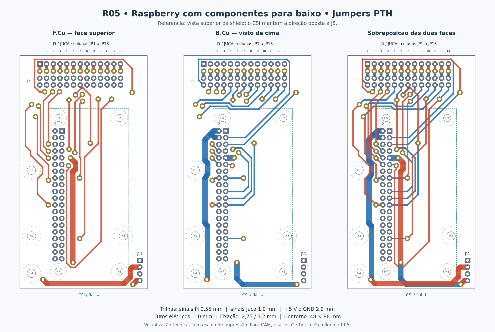
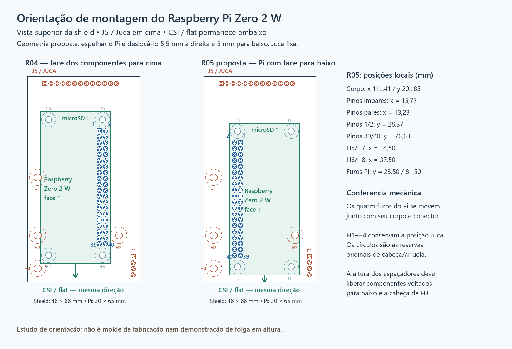

# Shield Juca / Raspberry Pi Zero 2 W — R05

**Estado: CAD roteado e verificado; preparação CAM e montagem física pendentes.** A R05 corrige a orientação de montagem do Raspberry e substitui os seletores SMD da R04 por jumpers PTH com capinha removível. O contorno da shield permanece em **48 × 88 mm**, com duas faces de cobre e espessura prevista de 1,6 mm.

Abra o [projeto KiCad](Juca_PiZero2_Shield_R05.kicad_pro), o [esquemático](Juca_PiZero2_Shield_R05.kicad_sch) ou a [PCB](Juca_PiZero2_Shield_R05.kicad_pcb). Os fontes desta revisão são trabalhados com **KiCad 9.0.8**. As bibliotecas locais devem acompanhar os arquivos; suas tabelas usam `${KIPRJMOD}`.

A [prévia vetorial do roteamento](documentacao/roteamento_R05.svg) apresenta F.Cu, B.Cu e sua sobreposição na mesma referência de vista superior. Para a preparação CAM, usar os arquivos de [fabricação](fabricacao/) e definir o espelhamento/registro de cada face conforme o processo da máquina. As prévias não têm escala de impressão garantida.

## Montagem do Raspberry

O Raspberry fica acima da shield, **com a face dos componentes voltada para baixo**, em direção à shield. Na vista superior, J5/Juca e microSD ficam no topo, e **CSI/flat permanece embaixo**, no lado oposto a J5. O soquete fêmea JPI1 continua na face superior da shield; o macho do Raspberry aponta para ele.

A nova posição resulta do espelhamento transversal do Pi seguido de deslocamento de **5,5 mm para a direita e 5 mm para baixo**. O deslocamento vertical abre espaço para distribuir as trilhas entre o banco de jumpers e o Raspberry. Não basta trocar a numeração das fileiras no lugar antigo: o header passa para o lado esquerdo do corpo do Pi. Os quatro furos do Raspberry acompanham seu deslocamento. J5, J11 e H1–H4 conservam as posições de encaixe com a Juca.

A [ilustração vetorial](documentacao/orientacao_R04_R05.svg) representa a montagem em planta, sem roteamento. **Não é molde de fabricação nem comprovação de folga em altura.**

Coordenadas locais em milímetros, medidas a partir do canto superior esquerdo da shield, com X para a direita e Y para baixo:

| Elemento | Posição na R05 |
|---|---|
| Corpo do Raspberry | X = 11 a 41; Y = 20 a 85 |
| JPI1, pinos ímpares | X = 15,77 |
| JPI1, pinos pares | X = 13,23 |
| Pinos 1/2 e 39/40 | Y = 28,37 e 76,63, respectivamente |
| H5 / H7, fixação Pi | X = 14,50; Y = 23,50 / 81,50 |
| H6 / H8, fixação Pi | X = 37,50; Y = 23,50 / 81,50 |

O **pino 1 quadrado fica no canto superior direito de JPI1**, próximo ao lado microSD; o pino 2 fica à sua esquerda. A numeração física de JPI1 continua seguindo o header do Raspberry. Na transformação da geometria recebida, `X_R05 = 46,5 − X_R04` e `Y_R05 = Y_R04 + 5` para os pads de JPI1. A mudança de destino elétrico de JP13 está indicada na tabela abaixo.

As legendas de orientação de JPI1, microSD e CSI pertencem à camada de documentação `Dwgs.User`; aparecem na vista de montagem que inclui essa camada. Os Gerbers de serigrafia usam as camadas `F.SilkS` e `B.SilkS`. Conferir o pad quadrado de JPI1 e a [pinagem oficial do Raspberry](https://www.raspberrypi.com/documentation/computers/raspberry-pi.html#gpio) ao posicionar o conector.

O corpo do Pi sobrepõe **H3, em X = 39 e Y = 68 mm**, em planta. Escolher a altura dos espaçadores a partir dos conectores encaixados, da cabeça do fixador H3 e dos componentes do Raspberry voltados para baixo. Os arquivos ainda não incluem um modelo 3D do conjunto montado que comprove essas folgas. A extremidade CSI fica em Y = 85 mm, **a 3 mm da borda da shield**; conferir o trajeto do flat e o acesso à trava do conector voltada para a shield. Planejar a colocação do fixador H3 e do cabo antes de encaixar o Raspberry.

Pelo desenho mecânico oficial, os centros de mini-HDMI, USB de dados e USB de alimentação ficam, nesta montagem, em Y = 32,4, 61,4 e 74,0 mm, respectivamente, na borda direita do Pi. O plugue de alimentação inserido pode passar sobre a região de J11; o USB de dados também fica próximo da projeção de H3. Isso exige conferir as alturas reais dos plugues, pinos soldados e fixadores, sem presumir colisão ou folga somente pela vista em planta. J11 é montado embaixo da shield, enquanto as tomadas do Pi ficam elevadas sobre ela.

## Jumpers PTH e conexões

JP1 a JP13 são **headers macho de dois pinos, passo 2,54 mm**, montados na face superior, fora do contorno do Pi e próximos a J5. Os headers são instalados; o estado inicial **aberto** significa **sem capinha**, e não componente ausente/DNP. A capinha removível une os dois pinos e habilita a linha correspondente. Alterar as capinhas com as alimentações desligadas.

Cada capinha deve unir os dois pinos da **mesma coluna JPn, no sentido Y**, entre Y = 8,50 e 11,04 mm. Conferir a largura dos corpos dos headers e das capinhas escolhidas: as colunas vizinhas também têm passo de 2,54 mm, sem espaço adicional previsto entre seus corpos nominais. O encaixe físico depende das dimensões dos componentes usados.

O número de cada JP corresponde ao pino de J5. **JP1–JP12 conservam o mapeamento da R04. JP13 conecta GPIO3 da Juca ao GPIO17 do Raspberry, no pino físico 11**, em X = 15,77 e Y = 41,07 mm. O destino anterior, GPIO24/pino físico 18, fica sem conexão na shield. As ligações de alimentação permanecem iguais às da R04.

| Jumper / J5 | Sinal Juca / GPIO ESP32-S3 | Pi físico / BCM |
|---|---|---|
| JP1 / 1 | SDA / 40 | 3 / 2 |
| JP2 / 2 | SCL / 39 | 5 / 3 |
| JP3 / 3 | TXD0 / 43 | 10 / 15, RX |
| JP4 / 4 | RXD0 / 44 | 8 / 14, TX |
| JP5 / 5 | GPIO38 | 24 / 8 |
| JP6 / 6 | GPIO37 | 21 / 9 |
| JP7 / 7 | GPIO36 | 23 / 11 |
| JP8 / 8 | GPIO35 | 19 / 10 |
| JP9 / 9 | GPIO45 | 15 / 22 |
| JP10 / 10 | GPIO48 | 12 / 18 |
| JP11 / 11 | GPIO47 | 33 / 13 |
| JP12 / 12 | GPIO46 | 16 / 23 |
| JP13 / 13 | GPIO3 | 11 / 17 |

O FollowBot exige **JP3 e JP4 fechados**: JP4 leva os comandos Pi → ESP, e JP3 traz os ACKs ESP → Pi. Porta UART, firmware e acionamento real continuam dependentes de integração. Os demais jumpers ficam abertos enquanto seu uso não estiver definido. Permanecem as [restrições de variante, memória e inicialização do ESP32-S3 descritas na análise da R04](../analise/REVISAO_R04.md#linhas-adicionais-e-variante-do-esp).

**A alimentação permanece conectada mesmo com todas as capinhas removidas:** J11-2 liga +5 V aos pinos físicos 2 e 4 do Pi; J11-4 liga GND ao pino físico 9. J11-1 (+BATT) e J11-3 (+3,3 V) permanecem sem ligação. A shield não oferece regulador, conversão de níveis nem seleção entre a alimentação da Juca e a do USB.

As trilhas mantêm **largura constante em cada rede**, inclusive nas trocas de face. As classes do projeto KiCad acompanham os valores abaixo. A capinha une duas redes distintas; a diferença de largura entre os lados Juca e Raspberry ocorre nesse componente.

| Grupo de trilhas | Largura anterior na R05 | Largura atual |
|---|---|---|
| Sinais do Raspberry (`PI_GPIO*`) | 0,508 mm | **0,55 mm** |
| Juca até os jumpers (`JUCA_*`) | 0,762 mm | **1,0 mm** |
| +5 V | 1,0 e 1,8 mm | **2,0 mm** |
| GND | 1,8 mm | **2,0 mm** |

O percurso de alimentação foi ajustado para eliminar o estreitamento em B.Cu. A largura de 0,55 mm nos sinais do Pi preserva a separação mínima de 0,508 mm nos trechos apertados; elevar todas essas trilhas a 0,60 mm na geometria avaliada violava essas separações. A [revisão elétrica e de layout](documentacao/REVISAO_ELETRICA_E_LAYOUT.md) reúne a conferência dos pinos, as correções de acesso à solda e as restrições de integração.

A capacidade de corrente ainda depende da espessura real do cobre, do comprimento das trilhas, dos contatos e das passagens entre faces. Medir em bancada a queda de tensão até os pinos de alimentação do Pi e o aquecimento com a câmera e o processamento em operação, incluindo os efeitos do acionamento dos motores sobre a alimentação fornecida pela Juca. Esses ensaios continuam pendentes.

## Furação e soldagem para CNC

Os **83 pads elétricos PTH** — 57 de conectores e 26 dos jumpers — usam furo de **1,0 mm**. As **41 vias** usam ilha de **2,0 mm** e furo de **1,0 mm**. São **124 furos elétricos de 1 mm** e **132 furos no total**, contando as oito fixações. Os furos mecânicos conservam seus diâmetros próprios: **H1–H4 com 3,2 mm**, para a Juca, e **H5–H8 com 2,75 mm**, para o Raspberry. Não substituir a furação mecânica final por furos de 1 mm.

J5/J11 ficam embaixo da shield e recebem as trilhas pela face superior **F.Cu**, acessível à solda. JPI1 e os headers JP ficam em cima e recebem suas conexões pela face inferior **B.Cu**. Entre J5 e o primeiro pad de cada JP há uma via dedicada: ela leva a conexão de F.Cu para B.Cu antes de alcançar o header superior. Essa organização evita depender de solda escondida sob o plástico do conector.

Em fabricação CNC sem metalização, cada via precisa de uma ligação física entre as faces. Usar fio compatível com o furo de 1 mm, soldado dos dois lados e cortado rente. Fazer e conferir essas passagens **antes de instalar os conectores**. Um furo sem metalização não liga as faces; não contar com o terminal de um header como transição entre camadas quando uma das soldas fica inacessível.

O banco de jumpers usa os mesmos alinhamentos X de J5: `X = 7,4744 + (n − 1) × 2,54`, para JPn. Seus pads ficam em Y = 8,50 e 11,04 mm; as vias de acesso a J5 ficam em Y = 5,80 mm. Essas 13 passagens estão incluídas no total de 41 vias.

O diretório [fabricacao](fabricacao/) contém **sete Gerbers** — duas faces de cobre, duas máscaras, duas serigrafias e o contorno —, o arquivo de job e o [Excellon combinado](fabricacao/Juca_PiZero2_Shield_R05.drl), com furos elétricos e mecânicos. Os diâmetros são **1,0 / 2,75 / 3,2 mm**. O exportador identifica vias e terminais de componentes como grupos distintos T1/T2, ambos com 1,0 mm; eles usam o mesmo diâmetro de broca. O [relatório de furação](fabricacao/relatorio_furacao_R05.txt) apresenta as contagens.

## Resultados de verificação e histórico

| Verificação | Resultado registrado |
|---|---|
| [DRC nativo, KiCad 9.0.8](verificacao/DRC_R05.json) | 0 violações, 0 conexões pendentes e 0 divergências reportadas com o esquemático |
| [ERC nativo, KiCad 9.0.8](verificacao/ERC_R05.json) | 0 violações |
| [Conferência estrutural](verificacao/ESTRUTURA_R05.json) | 408 verificações aprovadas; `PASS_BOUNDED_CHECKS_ONLY` |
| [Conferência das exportações](verificacao/FABRICACAO_R05.json) | 29 verificações aprovadas; os 132 furos exportados correspondem ao CAD |

O PCB possui **190 segmentos de trilha**, contra 452 na R04, e **41 vias**, contra 23. O aumento das passagens entre faces acompanha a troca dos seletores SMD por PTH, as chegadas às faces acessíveis à solda e a reorganização do roteamento. Essa comparação descreve a geometria; não estabelece ganho de desempenho elétrico.

Seis vias foram afastadas dos contornos nominais dos conectores para liberar suas ilhas de solda. A conferência das 41 vias contra esses contornos não encontrou sobreposições; a menor folga nominal é de 0,26 mm. Essa medida usa F.Fab nos jumpers e a representação em serigrafia nos demais headers, exigindo confirmação das dimensões dos componentes escolhidos.

Na conferência estrutural, não foram encontrados segmentos duplicados ou de comprimento zero, candidatos a pontas soltas, vias ligadas por apenas uma face ou mudanças de direção acima de 45° nas junções analisadas fora dos pads/vias. O verificador tem escopo limitado, descrito no próprio relatório; as verificações de separação e de regras elétricas são complementadas pelos relatórios nativos do KiCad.

As verificações digitais não comprovam montagem, capacidade de corrente, impedância ou comportamento eletromagnético. Confirmar a ferramenta efetiva de isolamento/furação, registro entre faces, espaçadores, soldabilidade e alimentação antes da fabricação e montagem.

As [instruções para repetir a verificação](verificacao/README.md) incluem os comandos de DRC/ERC e exportação. As vistas vetoriais nativas de [cima](documentacao/vista_superior_KiCad.svg) e [baixo](documentacao/vista_inferior_KiCad.svg) complementam a prévia; a vista inferior nativa está espelhada para representar a observação por baixo da placa.

A [R04 original](../R04/README.md), seus [fontes KiCad](../R04/Juca_PiZero2_Shield_R04.kicad_pro) e [arquivos recebidos de fabricação](../R04/fabricacao/) permanecem preservados como histórico. Seus Gerbers e PDF **não correspondem à R05**. As saídas próprias desta revisão estão em [fabricacao](fabricacao/); parâmetros de usinagem e geração de G-code pertencem à etapa CAM ainda pendente.

Referências para a montagem: [desenho mecânico oficial do Raspberry Pi Zero 2 W](https://datasheets.raspberrypi.com/rpizero2/raspberry-pi-zero-2-w-mechanical-drawing.pdf) e [pinagem GPIO oficial](https://www.raspberrypi.com/documentation/computers/raspberry-pi.html#gpio).
