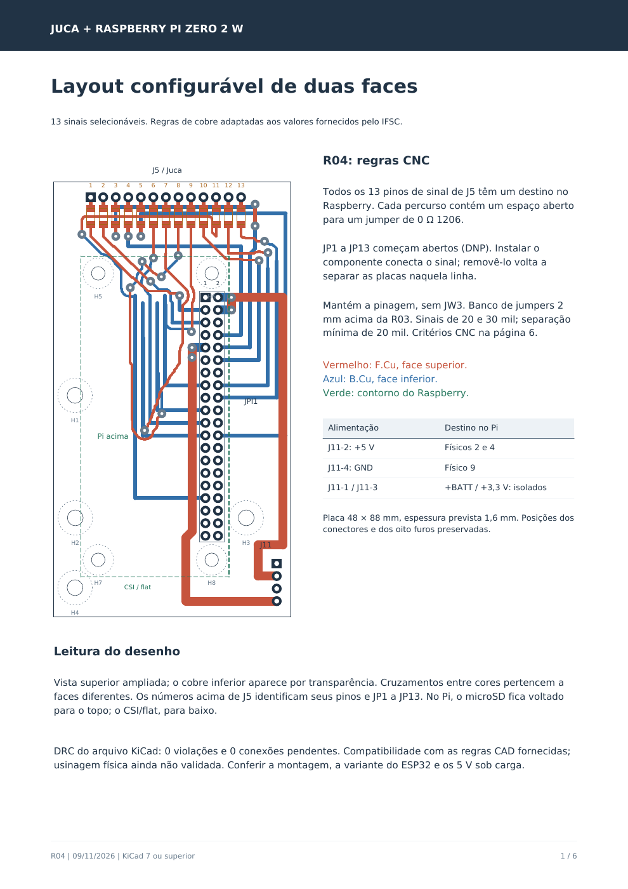

# Shield Juca / Raspberry Pi Zero 2 W

**Revisão CAD atual: [R05](R05/README.md)**, com Raspberry voltado para baixo, jumpers PTH com capinhas e furação elétrica de 1 mm. O roteamento está concluído, com DRC/ERC sem ocorrências. A R04 recebida em 16/11/2026 e a R02 permanecem preservadas como histórico. Fabricação, montagem e integração física com o carrinho ainda precisam de validação.

## Abrir a R05

- [Projeto KiCad](R05/Juca_PiZero2_Shield_R05.kicad_pro), [esquemático](R05/Juca_PiZero2_Shield_R05.kicad_sch) e [PCB](R05/Juca_PiZero2_Shield_R05.kicad_pcb).
- [Montagem, pinagem, furação e estado de verificação](R05/README.md).
- [Comparação visual da orientação do Raspberry](R05/documentacao/orientacao_R04_R05.png).
- [Prévia do roteamento nas duas faces](R05/documentacao/roteamento_R05.png), [Gerbers e furação](R05/fabricacao/) e [relatórios de verificação](R05/verificacao/README.md).

A R05 mantém o CSI oposto a J5, espelha a montagem do Pi e desloca seu conjunto 5,5 mm para a direita e 5 mm para baixo. JP1–JP12 e a alimentação conservam o mapeamento da R04; **JP13 passa de GPIO24/pino físico 18 para GPIO17/pino físico 11 do Raspberry**, mantendo GPIO3 da Juca como origem. O pino físico 18 fica sem conexão na shield. Seus arquivos devem ser usados em conjunto; as figuras, os moldes e os Gerbers da R04 abaixo documentam exclusivamente a revisão original.

## R04 recebida — referência histórica

A shield faz a interligação entre o Raspberry e a placa Juca do carrinho: encaminha alimentação e sinais e oferece suporte mecânico. A câmera permanece no CSI do Raspberry, e o acionamento dos motores fica na Juca/ESP32. A R04 tem **13 linhas de sinal selecionáveis**, cobre nas duas faces e **23 vias**.

### Arquivos originais da R04

- [Projeto KiCad](R04/Juca_PiZero2_Shield_R04.kicad_pro), [esquemático](R04/Juca_PiZero2_Shield_R04.kicad_sch) e [PCB](R04/Juca_PiZero2_Shield_R04.kicad_pcb).
- [Guia original de montagem e fabricação, com seis páginas](R04/Guia_de_montagem_R04.pdf).
- [README original](R04/README.md), [pinagem CSV](R04/pinagem_R04.csv) e [mapeamento JSON](R04/mapeamento_pinos.json).
- [Gerbers e Excellon](R04/fabricacao/).
- [Análise da R04 e comparação com a R02](analise/REVISAO_R04.md).

Abra o `.kicad_pro` com KiCad 7 ou posterior, conforme o pacote recebido. Mantenha juntos os fontes, `JucaShield.kicad_sym`, `JucaShield.pretty` e as tabelas locais de bibliotecas; elas usam `${KIPRJMOD}`. Para adaptar o circuito, trabalhe em uma nova revisão e regenere suas saídas de fabricação.



A imagem é uma prévia do guia original. O molde está na **página 5 do PDF da R04**: imprimir a 100% e conferir a barra de 50 mm. A prévia deste README não serve como máscara ou molde de fabricação.

## Conexões da R04 com o FollowBot — referência histórica

**Na R04, JP1 a JP13 começam abertos (DNP, sem componente montado).** São espaços para resistores/jumpers de **0 Ω em encapsulamento 1206**, que exigem soldagem. O número de cada JP corresponde ao pino de J5. Para a montagem com headers PTH e capinhas removíveis, seguir as [instruções da R05](R05/README.md#jumpers-pth-e-conexões).

| Ligação na R04 | Destino no Raspberry | Condição |
|---|---|---|
| J5-3, TXD0 do ESP → JP3 | Pino físico 10 / GPIO15, RX | Montar JP3 para receber os ACKs do ESP |
| J5-4, RXD0 do ESP ← JP4 | Pino físico 8 / GPIO14, TX | Montar JP4 para transmitir comandos ao ESP |
| J11-2, +5 V | Pinos físicos 2 e 4 | Ligação permanente |
| J11-4, GND | Pino físico 9 | Ligação permanente por cobre e vias, **sem JW3** |

O protocolo atual do FollowBot exige transmissão de comandos e retorno de ACK. Portanto, sua integração UART requer **JP3 e JP4**, além da configuração das duas pontas. Os GPIOs ESP indicados no mapeamento recebido são **43/TX e 44/RX, do ESP32-S3**; a correspondência com a Juca instalada ainda precisa ser conferida. Os demais seletores devem permanecer abertos enquanto seu uso não estiver definido.

J11-1 (+BATT), J11-3 (+3,3 V), o pino físico 6 do Raspberry e os pinos físicos 27/28 não recebem interligação na shield. O [mapeamento completo](R04/pinagem_R04.csv) inclui I²C, SPI e PWM/GPIO como possibilidades; habilitá-las depende da variante do ESP32-S3, dos níveis elétricos e do firmware. O fechamento de um JP apenas conecta a linha, sem configurar seu periférico.

A alimentação não passa pelos seletores: **deixar todos os JPs abertos não isola os 5 V nem o GND**. A R04 continua sem regulador, conversor de níveis ou gerenciamento de fontes. Confirmar a alimentação da Juca e sua convivência com o USB do computador antes do uso conjunto.

## Comparação histórica R02 e R04

| Característica | R02 | R04 |
|---|---|---|
| Dimensões | 48 × 88 mm | 48 × 88 mm |
| Cobre elétrico | B.Cu | F.Cu e B.Cu |
| Sinais | UART ligada diretamente | 13 percursos com seletores 0 Ω 1206, inicialmente abertos |
| Terra | Fio JW3 obrigatório | Trilhas e vias, sem JW3 |
| Vias | Nenhuma | 23; ilha de 1,8 mm e furo de 0,6 mm |
| Soldagem dos conectores | Cobre inferior; J5/J11 exigem acesso sob o soquete | J5/J11 recebem trilhas em F.Cu; JPI1 em B.Cu |
| Furação exportada | PTH e NPTH separados | Excellon único, 88 furos |

A **R03 não foi recebida**. As comparações com R03 no pacote original da R04 são informações fornecidas junto ao projeto; a comparação local usa R02 e R04. Em fabricação CNC sem metalização, as vias da R04 precisam de um processo de ligação elétrica entre as faces; perfurar não cria essa passagem.

## Organização e integridade

```text
Juca_PiZero2_Shield/
├── README.md
├── origem/       ZIPs originais R02 e R04
├── R02/          31 arquivos originais preservados
├── R04/          37 arquivos originais preservados
├── R05/          adaptação: Pi invertido, jumpers PTH e novo roteamento
└── analise/      análises, manifestos, verificadores e prévias
```

O [manifesto da R04](analise/manifesto_origem_R04.json) e o [manifesto da R02](analise/manifesto_origem.json) registram os hashes SHA-256 dos ZIPs e dos arquivos extraídos. Foi removida apenas a pasta externa de cada ZIP na extração; os bytes dos arquivos foram preservados. O `.gitattributes` impede conversão de finais de linha nos originais, inclusive após checkout em outro sistema.

As bibliotecas, documentos e relatórios recebidos fazem parte das respectivas revisões. As análises locais ficam em `analise/`. As fontes originais são preservadas sem atribuir a autoria das placas ao autor do TCC.

Para repetir as verificações estruturais, a partir da raiz do repositório:

```powershell
python Hardware/Juca_PiZero2_Shield/analise/verificar_r04.py
python Hardware/Juca_PiZero2_Shield/analise/verificar_r02.py
```

Os scripts são somente de leitura por padrão. Não substituem DRC/ERC nativo do KiCad nem testes de bancada. O verificador da R02 é específico da R02; o da R04 confere a nova organização de sinais e seletores.

## Histórico e integração

- [R02 original](R02/README.md), [guia da R02](R02/Guia_de_montagem_R02.pdf) e [análise da R02](analise/REVISAO_R02.md): referências históricas; a exigência de JW3 aplica-se à R02.
- [Análise da R04](analise/REVISAO_R04.md): revisão recebida e pendências de integração identificadas nessa análise.
- [FollowBot](../../followbot_mvp_audited/followbot_mvp_audited/README.md): o backend permite configurar uma porta serial, mas os perfis ainda usam exemplos USB. A UART no Ubuntu e o firmware real da Juca continuam pendentes de validação.
