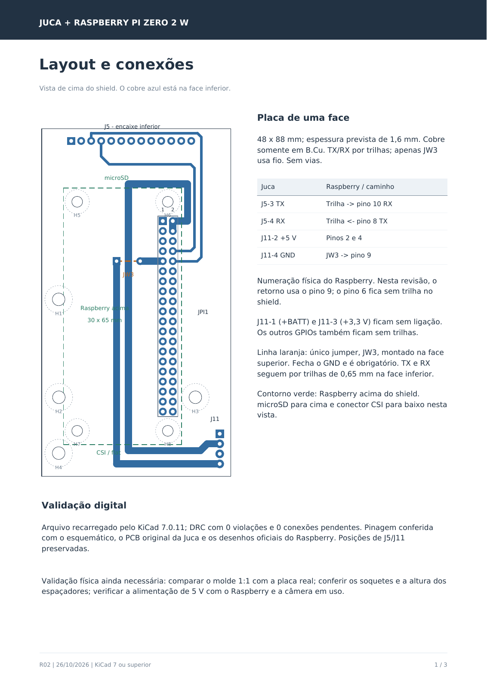

# Shield Juca / Raspberry Pi Zero 2 W

**Revisão de referência: R02, recebida e incorporada em 04/11/2026. Adaptações e integração física pendentes.**

Esta é a placa adaptadora prevista entre o Raspberry e a placa Juca do carrinho. Ela encaminha TX/RX, +5 V e GND e oferece pontos de fixação. A câmera continua conectada diretamente ao CSI do Raspberry; o acionamento dos motores continua a cargo da Juca/ESP32.

## Começar por aqui

- [Análise da R02 e plano de integração](analise/REVISAO_R02.md): o que foi conferido, diferenças em relação ao software e decisões para a próxima revisão.
- [Guia de montagem original, com vistas e molde](R02/Guia_de_montagem_R02.pdf).
- [Projeto KiCad](R02/Juca_PiZero2_Shield_R02.kicad_pro), [esquemático](R02/Juca_PiZero2_Shield_R02.kicad_sch) e [PCB](R02/Juca_PiZero2_Shield_R02.kicad_pcb).
- [README original](R02/README.md) e [arquivos de fabricação recebidos](R02/fabricacao/).



A imagem acima é uma prévia renderizada do PDF original. Para o molde em escala, use a página 3 do PDF, imprima a 100% e confira a barra de 50 mm; a imagem do README não é um molde de fabricação.

## Conexões essenciais

Os números do Raspberry abaixo são **pinos físicos** do conector. Os nomes `ESP_TX` e `ESP_RX` são vistos do lado do ESP32.

| Juca | Shield / Raspberry | Função |
|---|---|---|
| J5-3, TX | JPI1-10, GPIO15 / RX | ESP → Pi |
| J5-4, RX | JPI1-8, GPIO14 / TX | Pi → ESP |
| J11-2, +5 V | JPI1-2 e JPI1-4 | Alimentação encaminhada da Juca |
| J11-4, GND | JW3 → JPI1-9 | Terra comum; **JW3 obrigatório** |

A correspondência física dos pinos UART do Pi segue a [documentação oficial Raspberry Pi](https://www.raspberrypi.com/documentation/computers/configuration.html#configuring-uarts). A identificação dos pinos da Juca vem do pacote recebido e ainda precisa ser confrontada com a revisão real do carrinho.

J11-1 (+BATT), J11-3 (+3,3 V) e os demais pinos dos conectores não têm trilhas de interligação. O pino físico 6 do Pi também fica sem trilha nesta shield. A R02 possui cobre elétrico apenas em B.Cu, 24 segmentos de trilha e um jumper de fio isolado no topo. Não inclui regulador, conversor USB–serial, conversor de níveis ou gerenciamento de fontes.

## Como abrir e preservar a revisão

Abra o `.kicad_pro` com KiCad 7 ou posterior, conforme o guia recebido, mantendo juntos os arquivos em `R02/`. As bibliotecas locais usam `${KIPRJMOD}` e acompanham o projeto. Para alterações futuras, crie uma nova revisão; salve nela inclusive os arquivos que o KiCad converter ao migrar de versão.

```text
Juca_PiZero2_Shield/
├── README.md
├── origem/                    ZIP recebido, preservado
├── R02/                       31 arquivos originais, sem alterações
│   ├── *.kicad_pro / *.kicad_sch / *.kicad_pcb
│   ├── JucaShield.kicad_sym / JucaShield.pretty/
│   ├── Guia_de_montagem_R02.pdf
│   └── fabricacao/
└── analise/                   documentação e verificações do TCC
    ├── REVISAO_R02.md
    ├── manifesto_origem.json
    ├── verificar_r02.py
    ├── revisao_estrutural.json
    └── guia_montagem_pagina1.png
```

O [manifesto de origem](analise/manifesto_origem.json) registra SHA-256 do ZIP e de cada arquivo extraído. A pasta externa do ZIP foi removida na extração; os bytes dos arquivos foram preservados. O `.gitattributes` desativa conversão de finais de linha nos originais, para preservar esses hashes também após checkout em outro sistema. O pacote não identifica claramente a autoria da placa; mantivemos seus documentos, nomes e referências, sem atribuir a criação da R02 ao autor do TCC.

## Relação com o software

O [FollowBot](../../followbot_mvp_audited/followbot_mvp_audited/README.md) já aceita uma porta serial configurável. A shield prevê UART pelo header, enquanto os perfis atuais usam exemplos de serial USB. Será necessário identificar a UART disponível no Ubuntu, confirmar os GPIOs do ESP ligados a J5 e integrar o firmware do carrinho. Os arquivos da placa não comprovam essa etapa.

Para conferir novamente a integridade e a estrutura digital, a partir da raiz do repositório:

```powershell
python Hardware/Juca_PiZero2_Shield/analise/verificar_r02.py
```

O verificador é somente de leitura por padrão. Seu escopo e as verificações que ainda dependem de KiCad e bancada estão na [análise](analise/REVISAO_R02.md).
