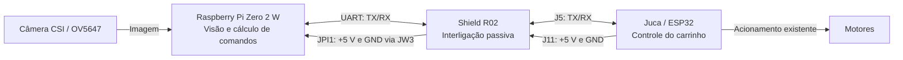

# Análise da shield Juca / Raspberry Pi Zero 2 W — R02

Data da incorporação e revisão: **04/11/2026**. Situação: **referência de projeto preservada; integração com o carrinho e adaptações futuras pendentes**.

## 1. Escopo e origem

O pacote `Juca_PiZero2_Shield_R02.zip` contém 31 arquivos: fontes KiCad, bibliotecas locais, guia PDF, geometria/conexões em JSON, relatórios de verificação e arquivos de fabricação. Foi preservado em [origem](../origem/Juca_PiZero2_Shield_R02.zip); a extração está em [R02](../R02/).

SHA-256 do ZIP: `24813ab56b0659a78ba4a868a0fb1c38c630ac9f55f9d493f36e0447d3c4913f`.

O guia e o relatório de DRC recebidos são datados de 26/10/2026. O guia menciona como origem mecânica da Juca o arquivo `robo_2wd.kicad_pcb` de `Juca-main.zip`. **Esse projeto completo da Juca não acompanha o pacote recebido.** Assim, a correspondência com a placa física e os números GPIO do ESP32 ainda não foram verificados independentemente.

O escopo desta revisão é a conferência dos arquivos de projeto. Montagem, alimentação e integração UART com o firmware real do carrinho permanecem pendentes de validação.

## 2. Função no sistema

O diagrama representa a integração **prevista**. A shield não processa comandos e não implementa controle de motores. A conexão USB usada para acesso SSH ao Raspberry é outra interface; sua alimentação precisa entrar na decisão de gerenciamento das fontes.

## 3. Conexões elétricas

| Rede no CAD | Pinos conectados por cobre | Papel |
|---|---|---|
| `ESP_TX` | J5-3 ↔ JPI1-10 | Saída do ESP → entrada RX do Pi |
| `ESP_RX` | J5-4 ↔ JPI1-8 | Saída TX do Pi → entrada do ESP |
| `+5V` | J11-2 ↔ JPI1-2 ↔ JPI1-4 | Um mesmo barramento de alimentação |
| `GND_JUCA` | J11-4 ↔ JW3-1 | Retorno do lado Juca |
| `GND_PI` | JW3-2 ↔ JPI1-9 | Retorno do lado Pi |

JW3 une fisicamente as duas redes de terra. Antes de montar o fio, elas são redes separadas no CAD; depois da montagem, formam o retorno comum previsto. O relatório de DRC sem conexões pendentes **não significa que esse fio possa ser dispensado**. O comprimento entre os furos de JW3 é 6 mm, além da sobra necessária para pernas e dobras.

Não há trilha para J11-1 (+BATT), J11-3 (+3,3 V), demais pinos de J5 nem demais pinos de JPI1, inclusive o pino físico 6. Não se deve deduzir continuidade na shield apenas porque um pino do header do Raspberry também se chama GND.

No Pi, pino físico 8 corresponde a GPIO14/TX e pino físico 10 a GPIO15/RX; a UART opera em **3,3 V**, conforme a [documentação oficial de UART](https://www.raspberrypi.com/documentation/computers/configuration.html#configuring-uarts). O +5 V da alimentação não é o nível elétrico dos sinais. A R02 não contém conversão de níveis. O esquema da Juca e a medição na bancada precisam confirmar o sinal efetivamente presente em J5.

## 4. Alimentação: principal ponto a fechar

A R02 apenas encaminha a tensão de J11-2 ao Pi. Não contém regulador, proteção de entrada ou circuito de seleção/isolamento de fontes. O README recebido menciona bateria de 6–12 V na **Juca**; isso não autoriza aplicar essa tensão ao Raspberry ou à entrada de 5 V da shield.

Antes de escolher uma adaptação, identificar o regulador da Juca, sua capacidade disponível, cargas compartilhadas e proteção existente. Medir tensão no J11 e no header do Pi durante inicialização, câmera, inferência e atividade dos motores. A largura de 1,8 mm das trilhas de alimentação, sozinha, não determina corrente admissível: faltam especificações confirmadas de cobre, conectores, temperatura e fonte.

O retorno da alimentação também passa pelo único JW3 e pelo pino 9. A montagem desse fio e de suas soldas faz parte do caminho de potência, além de fornecer referência para a UART.

O uso anterior de USB com o computador pode introduzir uma segunda alimentação. Definir como alimentar e depurar o conjunto antes de combinar +5 V da Juca com USB externo. A shield recebida não resolve essa seleção. Uma futura revisão pode incorporar uma solução, mas a topologia ainda depende das fontes reais.

## 5. Mecânica e componentes de montagem

| Item | Definição da R02 | Conferência ainda necessária |
|---|---|---|
| PCB | 48 × 88 mm; espessura prevista de 1,6 mm | Molde 1:1 contra a Juca real |
| J5 | Soquete fêmea 1×13, passo 2,54 mm, por baixo | Orientação do pino 1 e comprimento dos terminais |
| J11 | Soquete fêmea 1×4, passo 2,54 mm, por baixo | Pinagem de potência e encaixe sem deslocamento |
| JPI1 | Soquete fêmea 2×20, passo 2,54 mm, por cima | Header macho no Pi apontando para baixo |
| JW3 | Fio isolado; diâmetro de condutor proposto 0,5–0,65 mm | Solda, isolamento e espaço para montagem |
| H1–H4 | Furos 3,2 mm, fixação M3 | Coordenadas e ferragens da Juca |
| H5–H8 | Furos 2,75 mm, fixação M2,5 | Encaixe do Pi e folgas reais |

Todas as soldas elétricas são previstas em B.Cu. J5 e J11 ficam do mesmo lado do cobre; por isso o guia exige espaço de 2–3 mm sob o corpo plástico para acesso com o ferro. A cauda mínima ilustrativa de 5,1 mm resulta de 1,6 mm de placa + 3 mm de folga + 0,5 mm de protrusão. É uma condição de escolha do conector, não um código de peça já comprado.

Os furos H5–H8 formam um retângulo de 23 × 58 mm; correspondem ao padrão do Pi Zero 2 W, cuja placa mede 30 × 65 mm, no [desenho mecânico oficial](https://datasheets.raspberrypi.com/rpizero2/raspberry-pi-zero-2-w-mechanical-drawing.pdf). A posição indicada para o Pi é girada 90° no sentido horário em relação à referência descrita no pacote: microSD para cima e CSI para baixo na vista superior do guia.

Conferir acesso ao cartão e conectores USB, saída e curvatura do flat CSI, componentes abaixo do shield (incluindo a região do MPU-6050 citada no pacote), altura dos soquetes totalmente encaixados e dos espaçadores. O guia reserva raios de 3,5 mm para fixações Juca e 3,1 mm para fixações Pi; a folga mínima entre essas reservas é cerca de 0,74 mm, entre H4 e H7. Ela não comprova ausência de interferência com ferragens comerciais ou componentes da Juca. Os footprints recebidos não incluem modelos 3D para essa conferência.

## 6. Fabricação: guia manual e arquivos industriais

O layout tem trilhas e pads elétricos em B.Cu, sem vias nem zonas de cobre. As trilhas UART têm 0,65 mm de largura; alimentação e terra, 1,8 mm. A biblioteca e as tabelas de símbolos/footprints são locais ao projeto.

Há uma diferença que deve acompanhar qualquer pedido de fabricação:

- O guia descreve placa com cobre em uma face e soldagem manual sem necessidade de furos metalizados.
- O `.gbrjob` recebido declara **duas camadas**, com F.Cu e B.Cu no empilhamento, embora não haja Gerber F.Cu no pacote.
- O Excellon `-PTH.drl` classifica os **59 furos elétricos como metalizados**; `-NPTH.drl` contém os oito furos mecânicos.

Portanto, os arquivos recebidos não constituem por si só uma especificação industrial inequívoca de placa de uma face sem metalização. Definir o processo com o fabricante e, na revisão adaptada, gerar saídas coerentes com ele. Preservamos os arquivos recebidos para não confundir uma correção de fabricação com a R02 original.

O contorno nominal é 48 × 88 mm. O job registra aproximadamente 48,05 × 88,05 mm, incluindo a largura do traço de contorno; usar o contorno e conferir as dimensões, em vez de redesenhar a placa a partir desse resumo.

Os SVGs têm duas orientações explicitamente nomeadas: [vista inferior](../R02/fabricacao/cobre_B_Cu_vista_inferior.svg) e [cobre visto de cima](../R02/fabricacao/cobre_B_Cu_visto_de_cima.svg). O processo de transferência também pode inverter a imagem. O [guia original](../R02/Guia_de_montagem_R02.pdf) inclui o molde e a barra de 50 mm para conferência; a prévia do README não serve como máscara ou gabarito.

## 7. Integração com o FollowBot

| Parte | Implementado hoje | Necessário para a shield |
|---|---|---|
| Python | [`SerialCommunicationLink`](../../../followbot_mvp_audited/followbot_mvp_audited/src/followbot/communication/serial_link.py) recebe porta configurável | Selecionar a UART Linux confirmada; não há necessidade demonstrada de outro backend |
| Perfil Raspberry | [`rpi.example.toml`](../../../followbot_mvp_audited/followbot_mvp_audited/configs/profiles/rpi.example.toml) usa `/dev/ttyACM0`, 115200 baud | Criar perfil próprio após validar a UART; manter o exemplo USB |
| Ensaio de visão | [`rpi_vision.toml`](../../../followbot_mvp_audited/followbot_mvp_audited/configs/profiles/rpi_vision.toml) usa comunicação simulada | Continua adequado para testar visão isoladamente |
| ESP32 | [Exemplo](../../../followbot_mvp_audited/followbot_mvp_audited/esp32_example/esp32_velocity_receiver.ino) usa `Serial.begin(115200)` | Identificar GPIOs J5 na Juca e UART correspondente; integrar ao firmware real |
| Protocolo | `CMD,seq,linear,angular` / `ACK,seq`, 115200, 8N1 | Validar transporte UART e integridade com motores em operação |

No Ubuntu 24.04.4 do projeto, verificar o dispositivo de UART, permissões, pinmux e eventual console/getty usando os mesmos pinos. `/dev/serial0` é um candidato somente se existir e apontar para a UART desejada. A documentação Raspberry descreve a relação entre UART primária, miniUART, Bluetooth e clock; a configuração efetiva dessa imagem Ubuntu precisa ser inspecionada antes de aplicar ajustes. Não presumir os passos do Raspberry Pi OS. [Referência oficial](https://www.raspberrypi.com/documentation/computers/configuration.html#configuring-uarts).

O pacote da shield não informa os GPIOs do ESP32. Assim, ainda não cabe fixar `Serial2`, GPIO16/17 ou qualquer outro par. Verificar também se a UART escolhida compartilha o circuito de gravação/depuração da Juca. A [API Serial do Arduino-ESP32](https://docs.espressif.com/projects/arduino-esp32/en/latest/api/serial.html) permite selecionar RX/TX explicitamente, conforme o hardware e a versão do framework.

No exemplo do repositório, `applyVelocityReference()` ainda é um placeholder; o watchdog de 2000 ms chama essa mesma camada. Receber ACK prova uma resposta de protocolo, não que o motor obedeceu ou que a parada física está integrada. O parser também precisa de revisão de faixa, números finitos e mensagens malformadas. O protocolo atual não possui checksum; a justificativa baseada em USB precisa ser reavaliada para UART no conjunto com motores.

Após validar alimentação, pinagem e firmware, o [`serial_smoke_test.py`](../../../followbot_mvp_audited/followbot_mvp_audited/scripts/serial_smoke_test.py) existente permite testar somente comandos STOP, escolhendo a porta confirmada. Depois, validar a parada por perda de comunicação e só então testar movimento controlado. Nenhum desses ensaios foi executado nesta incorporação.

## 8. Evidências e limites da revisão

| Evidência | Origem e alcance |
|---|---|
| [Manifesto SHA-256](manifesto_origem.json) | Criado na importação; registra ZIP e bytes dos 31 arquivos |
| [DRC recebido](../R02/verificacao_DRC.txt) | Declara KiCad 7.0.11, zero violações, zero conexões pendentes e zero erros de footprints; não foi reexecutado nesta máquina |
| [Conexões recebidas](../R02/verificacao_conexoes.json) | Relatório original de conferência digital; preservado como evidência fornecida |
| [Verificador local](verificar_r02.py) e [resultado](revisao_estrutural.json) | Resultado `PASS_STRUCTURAL_CHECKS_ONLY`: 31 arquivos íntegros, 59 pads, 24 segmentos, oito furos, concordância pino a pino SCH/PCB/manifesto, continuidade dos grafos de extremidades e furação Excellon compatível com PCB |
| Guia de montagem | Três páginas lidas e inspecionadas visualmente; layout, montagem e molde |

Não foi localizado `kicad-cli` nesta máquina durante a revisão. A checagem por script não substitui parser nativo, DRC/ERC do KiCad, revisão dos Gerbers, cálculo térmico/elétrico nem ensaio de bancada. A ausência de vias e a conectividade digital não comprovam capacidade da fonte, estabilidade com motores ou compatibilidade mecânica com a Juca real.

## 9. Decisões para a próxima revisão

| Prioridade | Decisão / verificação | Evidência necessária |
|---|---|---|
| Antes da adaptação | Identificar revisão, esquema e PCB da Juca | Confirmar J5, J11, GPIOs ESP e furos |
| Antes da alimentação | Definir fonte e convivência com USB | Regulador identificado; medições com Pi, câmera e motores |
| Antes da montagem | Escolher conectores e espaçadores reais | Códigos das peças, medidas e molde conferido |
| Antes de fabricar | Escolher processo manual ou industrial | Camadas, metalização e arquivos de produção coerentes |
| Antes da comunicação | Configurar UART Pi/ESP | Porta, pinos e teste STOP/ACK documentados |
| Antes do movimento | Integrar protocolo, acionamento e parada | Unidades/faixas, watchdog e falhas ensaiados |
| Ao iniciar uma alteração | Criar próxima revisão, por exemplo R03 | Registro do motivo e diferenças em relação à R02 |

As adaptações específicas ainda serão alinhadas com o autor do TCC. Não há nova revisão de circuito criada nem componentes adicionais escolhidos nesta etapa.

Para a redação futura, este material cabe na metodologia/desenvolvimento: arquitetura física, função da interface, critérios elétricos e mecânicos e procedimento de validação. As medições reais devem entrar como resultados quando existirem. Não foi inserido no LaTeX texto afirmando que a shield já está montada ou validada.
